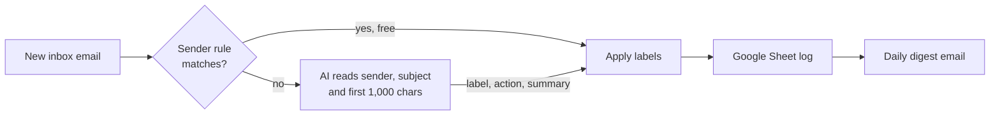

# email-sorter

**AI that labels your Gmail for about $1/month.**

email-sorter runs inside your own Google account on Google Apps Script, so there is no server to host. Every 10 minutes it reads your new inbox emails and has a cheap AI model give each one:

- **one category label**, such as `1 Orders` or `2 Opportunities`
- **⭐ Action** on top of the category, if the email needs you to do something
- **a one-line summary**, used in a daily digest email

All it does is apply labels. It never deletes, archives, replies to or moves your mail.

> 📸 **Screenshot placeholder:** Gmail inbox showing the coloured labels.
> Save it as `docs/inbox.png` and replace this block with ``.

> 📸 **Screenshot placeholder:** a daily digest email.
> Save it as `docs/digest.png` and replace this block with ``.

---

## How it works



1. **Trigger.** Every 10 minutes (configurable), Apps Script runs `run()`. It looks for inbox emails from the last 2 days that don't yet have the hidden `InboxSorter/Processed` label.
2. **Pre-filter.** If the sender matches one of your `senderRules` (for example `linkedin.com` → `3 LinkedIn`), the email is labelled straight away and the AI is skipped.
3. **AI.** Otherwise only the **sender, subject and first ~1,000 characters** of the body go to the AI. It returns `{label, action, summary}` as structured JSON. That answer is checked: an unknown label or malformed reply is rejected.
4. **Labels.** The thread gets its category label, plus `⭐ Action` if needed, plus the hidden `InboxSorter/Processed` label so it's never classified twice. If a new reply arrives in a thread, the thread is classified again and its category is replaced. `⭐ Action` is never removed, because clearing it is your job.
5. **Log.** Each run with new mail adds a row to the **Runs** tab of the Google Sheet the script is attached to: counts, label breakdown, tokens and estimated cost. Each email adds a row to the **Emails** tab, which the digest is built from.
6. **Digest.** Every day at 21:00 (or weekly, or never), you get one email:
   - `⭐ Action` items first, then `2 Opportunities`, then the other labels
   - one line per email: sender, summary and an **Open** link
   - LinkedIn and newsletters collapsed to a count
   - the total count and estimated API cost at the bottom

**Robustness:**
- If the AI call fails or returns something invalid, the email stays unlabelled and is retried on the next run.
- Each run stops after about 4 minutes, well inside Apps Script's 6-minute limit, and the next run carries on.
- A lock stops two runs from overlapping.

## What it costs

Apps Script is free. You pay only the AI provider. Each email is about **1,000 input tokens** (instructions, your About me, and the email) and **about 100 output tokens**.

| Emails per month | Claude Haiku 5.5 (default) | OpenAI gpt-6-luna | Gemini 3.1 Flash-Lite |
| ---: | ---: | ---: | ---: |
| 500 | $0.08 | $0.08 | $0.20 |
| 1,000 | $0.15 | $0.15 | $0.40 |
| 3,000 | $0.45 | $0.45 | $1.20 |
| 6,000 | $0.90 | $0.90 | $2.40 |
| One-off backlog of 850 | $0.13 | $0.13 | $0.34 |

These are estimates from list prices in November 2026, per million tokens: Haiku 5.5 and gpt-6-luna are $0.10 input / $0.50 output, and Gemini 3.1 Flash-Lite is $0.25 / $1.50. Emails caught by sender rules cost nothing.

> 📊 **Real numbers placeholder:** after a month of use, paste the totals from your Runs tab here (emails processed, tokens, cost).

---

## Setup (about 15 minutes)

### 1. Get an AI API key

Pick one provider. Anthropic is the default.

| Provider | Where to get a key | Script Property name |
| --- | --- | --- |
| Anthropic (Claude) | [console.anthropic.com](https://console.anthropic.com/) → API keys. Add a few dollars of credit. | `ANTHROPIC_API_KEY` |
| OpenAI | [platform.openai.com/api-keys](https://platform.openai.com/api-keys) | `OPENAI_API_KEY` |
| Google Gemini | [aistudio.google.com/apikey](https://aistudio.google.com/apikey) | `GEMINI_API_KEY` |

Keep the key somewhere safe for step 4. **Never paste it into a code file.**

### 2. Create the Google Sheet and script project

1. Go to [sheets.new](https://sheets.new) and name the spreadsheet **email-sorter**. This Sheet will hold the logs.
2. In the Sheet, open **Extensions → Apps Script**. A script editor opens, attached to this Sheet.
3. Rename the project (top left) to **email-sorter**.

Then copy the code in, using **either** route A or route B.

#### Route A: copy and paste (no tools needed)

1. In the Apps Script editor, open **⚙ Project Settings** and tick **"Show 'appsscript.json' manifest file in editor"**.
2. Go back to the **Editor** (`< >` icon). Open `appsscript.json` and replace its contents with [`src/appsscript.json`](src/appsscript.json) from this repo. This turns on the Gmail API service and sets the permissions.
3. Open `Code.gs` and replace its contents with [`src/Code.gs`](src/Code.gs).
4. For each of the other files, click **+ → Script**, type the name without `.gs`, and paste the contents in:
   - [`config.gs`](src/config.gs)
   - [`classify.gs`](src/classify.gs)
   - [`providers.gs`](src/providers.gs)
   - [`digest.gs`](src/digest.gs)
   - [`backlog.gs`](src/backlog.gs)
   - [`tests.gs`](src/tests.gs)
5. Click **💾 Save**.

#### Route B: clasp (for developers, keeps the repo in sync)

1. Turn on the Apps Script API at [script.google.com/home/usersettings](https://script.google.com/home/usersettings).
2. Install clasp and log in. This needs [Node.js](https://nodejs.org).
   ```bash
   npm install -g @google/clasp
   clasp login
   ```
3. Clone the repo and point it at your project. Find your **Script ID** under **⚙ Project Settings → IDs** in the Apps Script editor.
   ```bash
   git clone https://github.com/<you>/email-sorter.git
   cd email-sorter
   cp .clasp.json.example .clasp.json   # then paste your Script ID into .clasp.json
   clasp push                           # answer "y" to overwrite the manifest
   ```
4. Reload the Apps Script editor; the files appear there. From now on, edit locally and run `clasp push`. `.clasp.json` is gitignored, so your project ID stays private.

### 3. Set your time zone (if you're not in the UK)

`appsscript.json` sets `"timeZone": "Europe/London"`, which controls when the digest arrives. Change it to [your zone](https://en.wikipedia.org/wiki/List_of_tz_database_time_zones), for example `America/New_York`.

### 4. Add your API key

In the Apps Script editor, open **⚙ Project Settings → Script Properties → Add script property**:

- **Property:** `ANTHROPIC_API_KEY` (or `OPENAI_API_KEY` / `GEMINI_API_KEY`)
- **Value:** your key

Then click **Save script properties**.

### 5. Edit `config.gs`

At minimum, replace the example **`aboutMe`** with your own (see [Write your About me](#write-your-about-me)). Adjust the labels and sender rules to suit you. If you're not using Anthropic, change `provider`, `model` and `pricePerMillion`; a table of recommended models is in the file.

### 6. Run `setup()` and authorise

1. In the editor, pick **`setup`** in the function dropdown and click **▶ Run**.
2. Google asks you to authorise. Choose your account, and you'll see **"Google hasn't verified this app."** That's expected: it's your own script, not a published app, so the developer named there is you. Click **Advanced → Go to email-sorter (unsafe)**.
3. On the **"Select what email-sorter can access"** screen, tick **Select all**, then click **Continue**. All four permissions are needed (see the table below). If any are unticked, the script fails with a "required permissions" error.
4. The log should end with `Setup done.` setup() has now:
   - checked your config and API key
   - created any missing labels (reusing ones that already exist with the same name)
   - added the **Runs** and **Emails** tabs to your Sheet
   - installed the triggers (the 10-minute check and the digest)

**The permissions requested, and why:**

| Scope | Why |
| --- | --- |
| `gmail.modify` | Read emails, add labels, send the digest to yourself. It **cannot** permanently delete mail. |
| `script.external_request` | Call the AI provider |
| `script.scriptapp` | Install the timed triggers |
| `spreadsheets.currentonly` | Write logs to **this one Sheet only** |

After any later change to `config.gs`, run `setup()` again.

### 7. Test it, then label your backlog

1. Run **`selfTest`**. It checks the logic for free and should log `selfTest passed ✔`.
2. Run **`dryRun`**. It classifies your 5 newest inbox emails and logs `label | sender | summary` **without labelling anything**. If the results look wrong, tweak `aboutMe` or the label descriptions and try again.
3. Run **`run`** once. Check that the labels appear in Gmail and that a row appears in the **Runs** tab.
4. Optionally, run **`sendDigest`** to see a digest straight away.
5. Run **`startBacklog`** to label everything already in your inbox. It works through a batch every 5 minutes (roughly 850 emails in about an hour), writes a `backlog finished` row to the Runs tab, and then switches itself off. Backlog emails are not included in the digest.

That's it. The triggers now run on their own.

---

## Write your About me

`aboutMe` in `config.gs` is the only thing the AI knows about you, and it decides what gets **⭐ Action**. The example in the file describes a made-up student, so **replace it**. A good About me has:

1. **Who you are and what you're doing:** "I'm a final-year nursing student, job hunting, and I run a small Etsy shop."
2. **Your tie-breaker:** "I'd rather see one unimportant email marked Action than miss an important one" (or the opposite).
3. **A list of what counts as ACTION:** real people writing to you, deadlines, things you applied for, unexpected security alerts, money problems, plans changing soon.
4. **A list of what is NOT action:** marketing, notifications, receipts that need nothing from you, events you haven't signed up for.
5. **A default:** "When unsure, mark it as Action."

Be concrete. "Emails from my landlord" works better than "important housing stuff". Run `dryRun()` after each change to check.

**Keeping it private (clasp users with a public fork):** don't commit your About me. Put it in `src/config.local.gs`, which is gitignored, as `CONFIG.aboutMe = \`...\`;`. Apps Script loads that file after `config.gs`, so its values win, and `clasp push` still uploads it to your script.

---

## Configuration reference

Everything is in [`src/config.gs`](src/config.gs). After editing it, run `setup()` again.

| Setting | Default | What it does |
| --- | --- | --- |
| `provider` | `'anthropic'` | `'anthropic'`, `'openai'` or `'gemini'`. The matching API key must be in Script Properties. |
| `model` | `'claude-haiku-5-5'` | The model ID for that provider. Recommended models are listed in the file. |
| `pricePerMillion` | `{input: 0.10, output: 0.50}` | USD per million tokens. Only used for the cost estimates in the Sheet and digest. |
| `triggerMinutes` | `10` | How often new mail is checked. Must be 1, 5, 10, 15 or 30 (an Apps Script limit). |
| `batchSize` | `25` | The most emails one normal run handles. Any extra wait for the next run. |
| `backlogBatchSize` | `100` | The most emails one backlog run handles. Each run also stops after about 4 minutes. |
| `digest.frequency` | `'daily'` | `'daily'`, `'weekly'` or `'off'`. |
| `digest.hour` | `21` | The hour (0–23) the digest is sent, in your `timeZone`. Apps Script may run it any time within that hour. |
| `digest.weekday` | `'SUNDAY'` | The day for weekly digests. |
| `labels` | 6 labels | `{name, description, digest}`. The AI picks exactly one per email by reading the descriptions. `digest` is `'highlight'` (listed right after Action), `'show'` (listed) or `'count'` (collapsed to a count). |
| `actionLabel` | `'⭐ Action'` | Added on top of the category when an email needs you. |
| `digestLabel` | `'📋 Digest'` | Put on the digest emails. |
| `processedLabel` | `'InboxSorter/Processed'` | Hidden label that marks emails already handled. Remove it from an email to have it classified again. |
| `senderRules` | LinkedIn → `3 LinkedIn` | `{from, label, action}`. `from` is a full address or a domain (subdomains match too). A match skips the AI, and the subject becomes the digest summary. |
| `aboutMe` | example | Who you are and what counts as Action. See above. |

**Adding a provider:** add an entry to `PROVIDERS` in [`src/providers.gs`](src/providers.gs). Each entry has a `keyName`, a `request()` that builds the HTTP call, and a `parse()` that returns `{text, inputTokens, outputTokens}`. Then set `provider` to its name.

---

## Privacy

- **What leaves your Google account:** for each email, its **sender, subject and first ~1,000 characters of plain text** go to the AI provider you chose (Anthropic, OpenAI or Google). Attachments and the rest of the body are never sent. Emails matched by sender rules aren't sent at all. Each provider's API data policy applies.
- **What is stored:** nothing is stored outside your own Google account. The Sheet attached to the script holds the run logs, plus the sender, label and one-line summary of each email for the digest. Delete rows whenever you like.
- **Your API key** lives in Script Properties, never in the code.
- **Permissions:** the script can't permanently delete mail and can only touch its own Sheet (see the scope table in step 6).
- **This repo** contains no real email content, addresses or personal data. The `aboutMe` in `config.gs` is a clearly marked example.

## Troubleshooting

| Problem | Fix |
| --- | --- |
| `Missing API key: add …` | Add the key in **Project Settings → Script Properties**. The name must match exactly. |
| `ReferenceError: Gmail is not defined` | The Gmail API service is off. Paste [`src/appsscript.json`](src/appsscript.json) again, or add it with **Services + → Gmail API**. |
| `Please fix config.gs: …` | The message lists exactly what's wrong. Fix it and run `setup()` again. |
| Emails aren't being labelled | Check the **Failed** and **First error** columns in the Runs tab, and **Executions** in the Apps Script sidebar. |
| A label looks wrong | Make the label descriptions or `aboutMe` more specific, or add a sender rule, then run `dryRun()`. |
| The backlog stopped early | Its last row in the Runs tab shows the error. Fix it and run `startBacklog()` again. |
| You want to stop everything | Apps Script sidebar → **Triggers** → delete them. Your labels stay. |

## Licence

[MIT](LICENSE)
